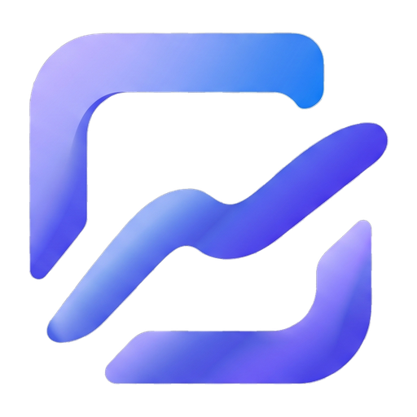

<div align="center">

# WriteCanvas

**Handwriting, notes and pages on a canvas that reads and writes the Scrble Ink file format.**

[](https://github.com/ThanhNguyxnOrg/WriteCanvas/actions/workflows/ci.yml)
[](https://github.com/ThanhNguyxnOrg/WriteCanvas/actions/workflows/codeql.yml)
[](https://github.com/ThanhNguyxnOrg/WriteCanvas/releases)
[](LICENSE)
[](package.json)
[](package.json)
[](#platform-support)
[](CONTRIBUTING.md)
[](https://www.conventionalcommits.org/)



</div>

## What it is

WriteCanvas is a desktop note-taking app for handwriting first. It opens an
existing **Scrble Ink** library, keeps every page in the PNG format that app
already uses, and writes them back so both applications can read the same
folder. On top of that format it adds the things a desktop workflow needs: real
pages with thumbnails, a pen and highlighter engine, a ruler, shapes and text,
PDF and `.wcanvas` export, autosave, and keyboard shortcuts that match the
platform you are on.

It runs on Windows, macOS and Linux from one code path. Linux is a first-class
target, not a fallback: the app ships an AppImage and a deb, and the shortcut
sheet names Linux chords explicitly.

## Highlights

| Area | What you get |
|---|---|
| **Notes that stay portable** | Pages are `Scribble/<Name>#NN.png` beside an `index.json`, with ink replay (`sINK`) and paper chunks preserved. Editable strokes live in a `sVec` extension, the raster base in `sRST`, so an imported page is never flattened away. |
| **Ink engine** | Five pen types with the factory 29-colour palette, per-pen width and colour, custom hex and a colour picker. Translucent pens composite once per stroke, so a highlighter does not darken itself where it crosses. |
| **Paper** | Letter, Legal, Tabloid and A0–A6, with blank, pattern and planner templates rendered at the original document scale. |
| **Tools** | Pen, highlighter, eraser (stroke, segment, sheet), laser pointer, ruler with snap and rotation, shapes and text boxes, click or lasso selection with move, duplicate and delete. |
| **Pages** | Add, duplicate, delete, reorder and turn pages with a continuous scroll, page thumbnails and right-click actions. |
| **Board colour** | Per page by default, or applied to the whole note on request. The interface theme is separate and never changes a board. |
| **Saving** | Debounced autosave, an explicit save for all changed pages, and export to PDF (page or whole note), PNG, or a portable `.wcanvas` container. |
| **Keyboard** | Shortcuts resolved for Windows, macOS and Linux, with an in-app help sheet that advertises only your platform's chords. |

## Getting started

Grab an installer from [Releases](https://github.com/ThanhNguyxnOrg/WriteCanvas/releases)
— NSIS on Windows, DMG on macOS, AppImage or deb on Linux — or run it from source:

```bash
git clone https://github.com/ThanhNguyxnOrg/WriteCanvas.git
cd WriteCanvas
npm ci
npm start
```

The builds are unsigned, so Windows and macOS will warn the first time you run the
installer (`docs/RELEASING.md` explains why). On first launch the app offers a
library folder and defaults to `Documents/WriteCanvas`. Point it at an existing
Scrble Ink library to read the notes you already have; the app never modifies a
page until you draw on it.

| Command | What it does |
|---|---|
| `npm start` | Run the app. |
| `npm run start:debug` | Run with the DevTools protocol on port 9222, for the CDP scripts. |
| `npm test` | Run the unit suite (plain `node:test`, no Electron needed). |
| `npm run pack` | Build an unpacked app for the current OS. |
| `npm run dist` | Build the installers: NSIS, DMG, AppImage and deb. |

## Documentation

Everything longer than a screen lives in [`docs/`](docs/README.md). The table
below is the whole set; each page is self-contained.

| Document | Read it when you want to |
|---|---|
| [docs/README.md](docs/README.md) | Pick the right document from an index organised by audience. |
| [docs/ARCHITECTURE.md](docs/ARCHITECTURE.md) | Understand the processes, the canvas layers, the module map and the save pipeline. |
| [docs/FORMAT.md](docs/FORMAT.md) | Know exactly what a note file contains: every ancillary chunk, the `sVec` payload, the `.wcanvas` container. |
| [docs/DEVELOPMENT.md](docs/DEVELOPMENT.md) | Set up a working copy, use the dev scripts, and keep your real library out of harm's way. |
| [docs/TESTING.md](docs/TESTING.md) | Run and extend the unit suite, and exercise the app without touching real notes. |
| [docs/PLATFORMS.md](docs/PLATFORMS.md) | Check per-OS behaviour, packaging targets and the full shortcut table. |
| [docs/AUTOMATION.md](docs/AUTOMATION.md) | Trace what CI, Dependabot, CodeQL and ThanhNguyxnAgent do, and which pull requests they will not touch. |
| [docs/RELEASING.md](docs/RELEASING.md) | Cut a release, and understand how a `release:` commit becomes a tag and a GitHub Release. |
| [CHANGELOG.md](CHANGELOG.md) | See what shipped in each version. |
| [CONTRIBUTING.md](CONTRIBUTING.md) | Send a change: branch, commit style, review expectations, test requirements. |
| [SECURITY.md](SECURITY.md) | Report a vulnerability privately, and see what is in scope. |
| [CODE_OF_CONDUCT.md](CODE_OF_CONDUCT.md) | Know the behaviour expected in issues, pull requests and discussions. |

## Compatibility

| Direction | Status |
|---|---|
| Read a Scrble Ink library | Supported. Ink-only pages written by Scrble Ink are imported as a raster base and stay editable on top. |
| Open a note written by WriteCanvas in Scrble Ink | Supported. The flattened image is written to `IDAT` and the private chunks keep their original meaning, so the other app sees an ordinary note. |
| Keep the replay animation | Supported. The drawing GIF is embedded in `sINK`, as the original app does. |
| Fully lossless round trip | Not guaranteed for pages drawn in Scrble Ink itself: vector data does not exist in those files, so WriteCanvas re-rasterises them. |

## Platform support

| | Windows | macOS | Linux |
|---|---|---|---|
| Run from source | yes | yes | yes |
| Installer | NSIS | DMG | AppImage, deb |
| Interface shortcuts | `Ctrl` | `⌘` | `Ctrl` |
| Redo chord | `Ctrl+Y` | `⇧⌘Z` | `Ctrl+Y` |

## Contributing, security, licence

- Contributions are welcome — start with [CONTRIBUTING.md](CONTRIBUTING.md) and
  the [architecture notes](docs/ARCHITECTURE.md).
- Report vulnerabilities privately through
  [SECURITY.md](SECURITY.md), never in a public issue.
- Licensed under the [Apache License 2.0](LICENSE).

<div align="center">
<sub>Built with Electron and a hand-written Canvas 2D inking stack. No framework, no telemetry.</sub>
</div>